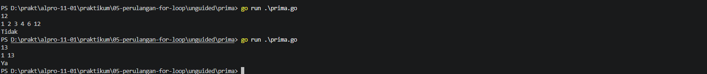
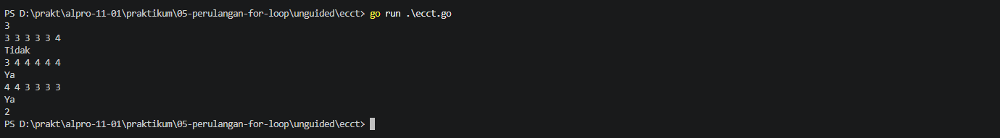

# <h1 align="center">Laporan Praktikum Modul 05 - Perulangan For</h1>
<p align="center">Zeda Briyan Dinillah - 109092600014</p>

## Dasar Teori

### A. Pengertian dan Fungsi Perulangan `for`
`for` merupakan _looping construct_ satu-satunya dalam Go, karena Go tidak memiliki `while` dan `do-while`. Fungsi utama dari `for` yaitu untuk mengeksekusi kode didalamnya secara berulang selama kondisi-kondisinya terpenuhi. 

### B. Tiga Komponen Perulangan `for`
Tiga komponen `for` diantaranya:
1. Inisialisasi, atau _init_, program didalamnya akan dieksekusi sekali diawal sebelum perulangan dimulai. Bagian ini biasanya berisi nilai awal dari variabel pembanding, seperti `i := 0`.
2. Kondisi, atau _condition_, program didalam kondisi akan dievaluasi sebelum setiap iterasi dijalankan. Jika bernilai `true`, maka kode didalam `for` akan dieksekusi, jika `false` maka perulangan akan berhenti.
3. _Post-statement_, program didalam _post-statement_ akan dieksekusi pada setiap iterasi berakhir setelah kode didalam kondisi selesai dieksekusi. Biasa digunakan untuk mengubah nilai variabel pembanding, seperti `i++`.

## Guided

### 1. Nama File: tabungan.go

```go
package main
import "fmt"

func main() {
	var a, b, n int
	fmt.Scan(&a, &b, &n)
	total := 0;
	tabunganHariIni := a;

	for i := 1; i <= n; i++ {
		total = total + tabunganHariIni

		tabunganHariIni = tabunganHariIni + b
	}
	fmt.Println(total)
}
```
#### Deskripsi
Membuat program untuk mengkalkulasi total tabungan, dengan $a$ sebagai nominal hari pertama menabung, dan setiap harinya bertambah $b$ rupiah dari hari sebelumnya. Program ini menggunakan `for` untuk menghitung penjumlahan total tabungan.

### 2. Nama File: terbesar.go

```go
package main
import "fmt"

func main() {
	var n int
	fmt.Scan(&n)

	var angka, max int
	fmt.Scan(&angka)
	max = angka
	
	for i := 2; i <= n; i++ {
		fmt.Scan(&angka)

		if angka > max {
			max = angka 
		}
	}
	fmt.Println(max)
}
```
#### Deskripsi
Membuat program untuk mencari bilangan terbesar dari $n$ buah bilangan bulat yang dimasukkan. Program menggunakan `for` untuk mencari bilangan terbesar.

### 3. Nama File: bioskop.go

```go
package main

import "fmt"

func main() {
	var t int
	fmt.Print("Input t (jumlah transaksi): ")
	fmt.Scan(&t)
	totalPendapatan := 0

	for i := 1; i <= t; i++ {
		var jenisFilm, hari string
		var jumlahTiket int

		fmt.Printf("Input transaksi ke-%d (jenis, hari, tiket): ", i)
		fmt.Scan(&jenisFilm, &hari, &jumlahTiket)

		hargaSatuan := 0

		if hari == "Senin" || hari == "Selasa" || hari == "Rabu" || hari == "Kamis" {
			if jenisFilm == "Reguler" {
				hargaSatuan = 40000
			} else if jenisFilm == "IMAX" {
				hargaSatuan = 80000
			} else if jenisFilm == "3D" {
				hargaSatuan = 60000
			}
		} else if hari == "Jumat" || hari == "Sabtu" || hari == "Minggu" {
			if jenisFilm == "Reguler" {
				hargaSatuan = 50000
			} else if jenisFilm == "IMAX" {
				hargaSatuan = 90000
			} else if jenisFilm == "3D" {
				hargaSatuan = 70000
			}
		}
		totalHarga := hargaSatuan * jumlahTiket

		if jumlahTiket >= 5 {
			diskon := (totalHarga * 10) / 100
			totalHarga = totalHarga - diskon
		}
		fmt.Printf("Output total harga transaksi ke-%d: %d\n", i, totalHarga)

		totalPendapatan = totalPendapatan + totalHarga
	}
	fmt.Println("Output total pendapatan: ", totalPendapatan)
}
```
#### Deskripsi
Membuat program untuk menghitung total pendapatan dari penjualan tiket suatu bioskop. Program menggunakan `for` untuk menghitung total harga berdasarkan jenis film, hari pemutaran, dan jumlah tiket yang dibeli.

## Unguided

### 1. Prima

```go
package main
import "fmt"

func main() {
	var n int
	fmt.Scan(&n)
	jumlahFaktor := 0

	for i := 1; i <= n; i++ {
		if n % i == 0 {
			fmt.Printf("%d ", i)
			jumlahFaktor++
		}
	}

	fmt.Println()

	if jumlahFaktor == 2 {
		fmt.Println("Ya")
	} else {
		fmt.Println("Tidak")
	}
}
```

##### Output



#### Deskripsi
Membuat program untuk menampilkan seluruh faktor dari bilangan positif $n$. Kemudian, program menentukkan apakah bilangan tersebut merupakan bilangan prima atau bukan. `for` digunakan untuk mengecek faktor dari $n$.


### 2. ECCT

```go
package main
import "fmt"

func main() {
	var m int 
	fmt.Scan(&m)
	lulus := 0

	for i := 1; i <= m; i++ {
		var P, V, GA, FS, CI, TC int
		fmt.Scan(&P, &V, &GA, &FS, &CI,&TC)

		total := P + V + GA + FS + CI + TC
		rataRata := float64(total) / 6.0

		if rataRata >= 3.33 {
			fmt.Println("Ya")
			lulus++
		} else {
			fmt.Println("Tidak")
		}
	}
	fmt.Println(lulus)
}
```

##### Output


#### Deskripsi
Membuat program untuk menentukan apakah mahasiswa baru Tel-U dalam satu kelompok bisa mendapatkan sertifikat ECCT atau tidak. `for` digunakan untuk menghitung rata-rata nilai dari mahasiswa-mahasiswa tersebut.

## Kesimpulan

1. `for` merupakan _looping construct_ satu-satunya dalam Go.
2. Fungsi dari `for` adalah untuk mengeksekusi kode didalamnya selama kondisi yang diberikan terpenuhi.
3. `for` memiliki tiga komponen utama, yaitu inisialisasi, kondisi, dan _post-statement_.

## Referensi
1. Go Team. (2026). _The Go Programming Language Specification_. Google LLC. Diakses pada 15 Oktober 2026 melalui https://go.dev/ref/spec.
2. Go Team. (2026). _A Tour of Go_. Google LLC. Diakses pada 16 Oktober 2026 melalui https://go.dev/tour/flowcontrol/1.