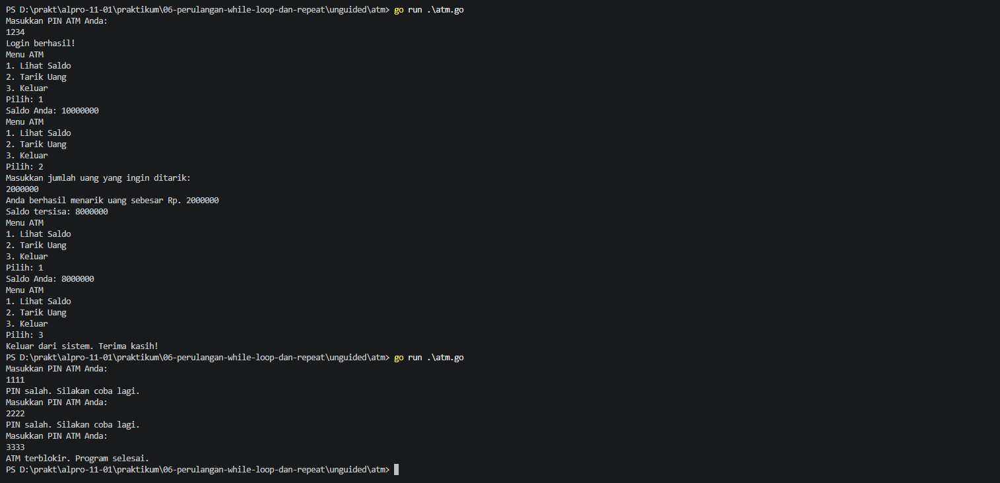

# <h1 align="center">Laporan Praktikum Modul 06 - Perulangan While</h1>
<p align="center">Zeda Briyan Dinillah - 109092600014</p>

## Dasar Teori

### A. Perulangan `while`
Perulangan `while` adalah suatu perulangan yang digunakan untuk menjalankan baris kode didalamnya secara berulang-ulang sampai suatu kondisi tercapai atau bernilai `true`. Perulangan jenis ini biasanya digunakan ketika jumlah iterasi belum diketahui secara pasti sedari awal.
Go tidak memiliki deklarasi `while`nya tersendiri, akan tetapi dideklarasikan dengan menggunakan `for` dan diikuti oleh kondisi.

## Guided

### 1. Nama File: terkecil.go

```go
package main
import "fmt"

func main() {
	var batas int
	fmt.Scan(&batas)
	n := 1

	for n * n * n <= batas {
		n++
	}
	fmt.Println(n)
}
```
#### Deskripsi
Membuat program untuk mencari bilangan bulat terkecil $n$, sehingga $n^3$ lebih besar dari _input_. Program menggunakan perulangan `while` untuk menghitung nilai $n$, mulai dari 1 keatas hingga menemukan bilangan terkecil $n$ yang memenuhi syarat.

### 2. Nama File: terbesar.go

```go
package main
import (
	"fmt"
	
)

func main() {
	var batas int
	fmt.Scan(&batas)
	n := 1

	for n * n < batas {
		n++
	}
	fmt.Println(n - 1)
}
```
#### Deskripsi
Membuat program untuk mencari bilangan bulat terbesar $n$, sehingga $n^2$ kurang dari batas _input_. Program menggunakan perulangan `while` untuk mencari bilangan $n$ yang memenuhi kondisi dan kemudian menampilkan nilai $n$ terbesar yang memenuhi syarat.

### 3. Nama File: vokal.go

```go
package main
import (
	"bufio"
	"fmt"
	"os"
	"strings"
)

func main() {
	reader := bufio.NewReader(os.Stdin)
	kalimat,_ := reader.ReadString('\n')

	i := 0
	jumlahVokal := 0

	for i < len(kalimat) {
		ch := strings.ToLower(string(kalimat[i]))
		if ch == "a" || ch == "i" || ch == "u" || ch == "e" || ch == "o" {
			jumlahVokal++
		}
		i++
	}
	fmt.Println(jumlahVokal)
}
```
#### Deskripsi
Membuat program untuk menghitung total huruf vokal yang terdapat pada kalimat yang di-_input_-kan. Program menggunakan perulangan `while` untuk memeriksa setiap karakter, dan baru berhenti ketika semua karakter telah diperiksa.

## Unguided

### 1. ATM

```go
package main
import "fmt"

func main() {
	var PIN, pilih, saldo, tarik int
	saldo = 10000000
	i := 0
	benar := false

	for i < 3 {
		fmt.Println("Masukkan PIN ATM Anda:")
		fmt.Scan(&PIN)
		i++

		if PIN == 1234 {
			fmt.Println("Login berhasil!")
			benar = true
			break
		} else {
			if i < 3 {
				fmt.Println("PIN salah. Silakan coba lagi.")
			}
		}
	}

	if benar == false {
		fmt.Println("ATM terblokir. Program selesai.")
		return

	}
	
	menu:
	for {
		fmt.Println("Menu ATM")
		fmt.Println("1. Lihat Saldo")
		fmt.Println("2. Tarik Uang")
		fmt.Println("3. Keluar")
		fmt.Print("Pilih: ")
		fmt.Scan(&pilih)

		switch pilih {
		case 1:
			fmt.Println("Saldo Anda:", saldo)
		case 2:
			fmt.Println("Masukkan jumlah uang yang ingin ditarik:")
			fmt.Scan(&tarik)
			saldo -= tarik
			fmt.Println("Anda berhasil menarik uang sebesar Rp.", tarik)
			fmt.Println("Saldo tersisa:", saldo)
		case 3:
			fmt.Println("Keluar dari sistem. Terima kasih!")
			break menu
		}
	}
}
```

##### Output



#### Deskripsi
Membuat program simulasi mesin ATM dengan ketentuan:
1. Pengguna diharuskan untuk memasukkan PIN untuk mengakses ATM.
2. PIN ATM yang benar adalah `1234`
3. Batas maksimal salah memasukkan PIN adalah 3 kali sebelum kartu ATM terblokir dan program berakhir.
4. Jika PIN yang dimasukkan benar, maka akan muncul 3 menu ATM yang bisa pengguna gunakan, yaitu `1` untuk melihat saldo, `2` untuk menarik uang, dan `3` untuk keluar
5. Jumlah saldo awal adalah 10.000.000

Program ini menggunakan perulangan `while` selama proses login (memasukkan PIN), karena program akan terus mengulang selama belum mencapai 3 kali percobaan. Perulangan `while` juga digunakan pada menu ATM, selama pengguna belum menekan `3` untuk keluar, program akan terus melakukan proses pengulangan.


## Kesimpulan
1. `while` merupakan perulangan yang akan menjalankan kode didalamnya sampai suatu kondisi tercapai.
2. Perulangan `while` biasanya digunakan saat jumlah iterasi belum diketahui.
3. Go menggunakan deklarasi `for` untuk melakukan perulangan `while`.