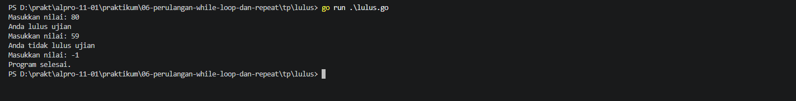
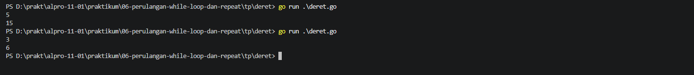
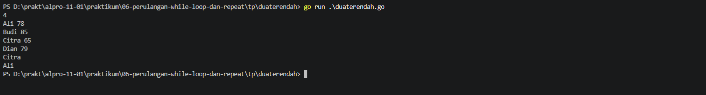
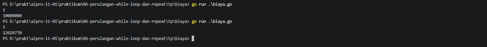

# <h1 align="center">Tugas Pendahuluan Modul 06 - Perulangan While</h1>
<p align="center">Zeda Briyan Dinillah - 109092600014</p>

### 1. lulus.go

```go
package main
import "fmt"

func main() {
	var nilai int

	for {
		fmt.Print("Masukkan nilai: ")
		fmt.Scan(&nilai)

		if nilai < 0 {
			fmt.Println("Program selesai.")
			break
		}

		if nilai >= 60 {
			fmt.Println("Anda lulus ujian")
		} else {
			fmt.Println("Anda tidak lulus ujian")
		}
	}
}
```

#### Output



#### Deskripsi
Program untuk mengecek nilai ujian secara berulang. Jika nilai yang dimasukkan lebih besar atau sama dengan 60, program akan menampilkan pesan "Anda lulus ujian". Jika tidak, program akan menampilkan pesan "Anda tidak lulus ujian".

### 2. deret.go

```go
package main
import "fmt"

func main() {
	var n int
	jumlah := 0
	fmt.Scan(&n)

	for i := 1; i <= n; i++ {
		jumlah += i
	}
	fmt.Println(jumlah)
}
```

#### Output



#### Deskripsi
Program untuk menghitung jumlah dari sederet angka yang dimasukkan menggunakan perulangan. Keluaran berupa penjumlahan dari 1 hingga ke _input_ atau `n`.

### 3. duaterendah.go

```go
package main
import "fmt"

func main() {
	var n int
	fmt.Scan(&n)
	min1, min2 := 999999, 999999
	namaMin1, namaMin2 := "", ""

	for i := 0; i < n; i++ {
		var nama string
		var nilai int
		fmt.Scan(&nama, &nilai)

		if nilai < min1 {
			min2 = min1
			namaMin2 = namaMin1
			min1 = nilai
			namaMin1 =  nama
		} else if nilai < min2 {
			min2 = nilai
			namaMin2 = nama
		}
	}
	fmt.Println(namaMin1)
	fmt.Println(namaMin2)
}
```

##### Output



#### Deskripsi
Program untuk menemukan dua nilai terendah. Masukkan berupa bilangan positif yang menyatakan jumlah siswa (`n`), lalu diikuti dengan sebanyak baris `n` _input_ berisi nama siswa dan nilainya.

### 4. biaya.go

```go
package main
import "fmt"

func main() {
	var n int
	fmt.Scan(&n)
	biaya := 10000000.0

	for i := 2; i <=n; i++ {
		perTahun := biaya * 0.06
		biaya += perTahun
	}
	fmt.Printf("%.0f\n", biaya)
}
```
#### Output



#### Deskripsi
Program untuk menghitung perkiraan biaya kuliah setiap tahun sampai tahun ke-`n`, dengan biaya awal kuliah adalah Rp. 10.000.000 dan setiap tahunnya bertambah sebesar 6% dari tahun sebelumnya.

## Kesimpulan
Kesimpulan dari tugas pendahuluan ini yaitu penggunaan perulangan `while` dengan menggunakan `for` dan cara implementasinya pada sebuah program.