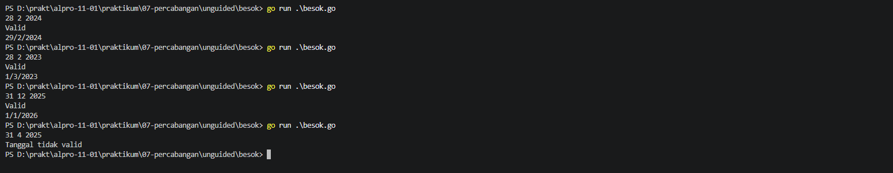
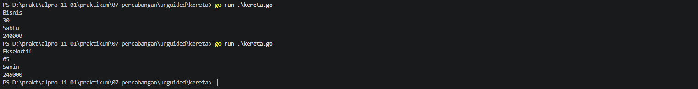

# <h1 align="center">Laporan Praktikum Modul 07 - Percabangan</h1>
<p align="center">Zeda Briyan Dinillah - 109092600014</p>

## Dasar Teori

### A. Pengertian Percabangan
Percabangan pada bahasa Go adalah suatu _control structure_ yang berfungsi seperti penunjuk arah. Dengan percabangan, program dapat mengeksekusi kode yang berbeda sesuai dengan syarat yang terpenuhi.

### B. Jenis Percabangan
#### 1. Percabangan `if`, `if-else`, dan `else-if`
Percabangan ini menjalankan program berdasarkan kondisi `true` atau `false`.
- `if`, akan menjalankan kode didalamnya hanya jika kondisinya terpenuhi.
- `if-else`, jika kondisi bernilai `true`, maka kode didalam `if` akan dijalankan, jika tidak, maka kode didalam `else` yang akan dijalankan.
- `else-if`, jika kondisi pertama `true`, maka kode akan dijalankan, jika tidak, program mengecek kondisi-kondisi berikutnya sampai nilainya `true`. Jika tidak ada satupun yang bernilai `true`, maka kode didalam `else` yang akan dijalankan sebagai pilihan terakhir.
#### 2. Percabangan `switch`
Percabangan ini akan mencocokkan nilai variabel dengan `case` yang ada didalamnya. Jika ditemukan `case` dengan nilai yang cocok, maka kode didalam `case` tersebut akan dijalankan, dan percabangan akan otomatis berhenti. Jika tidak ada satupun nilai didalam `case` yang cocok, maka kode didalam `default` yang akan dijalankan. Jenis percabangan ini biasanya lebih rapi dan mudah dibaca dibandingkan denga percabangan `if`.

## Guided

### 1. Nama File: kabisat.go

```go
package main
import "fmt"

func main() {
	var tahun int
	fmt.Scan(&tahun)

	if (tahun % 400 == 0) || (tahun % 4 == 0 && tahun % 100 != 0) {
		fmt.Println("Ya")
	} else {
		fmt.Println("Tidak")
	}
}
```
#### Deskripsi
Membuat program untuk menentukan apakah sebuah tahun merupakan kabisat atau bukan. Percabangan digunakan untuk mencari kabisat, dengan $kabisat$ = ($tahun$ $mod$ $400$ = $0$) atau ($tahun$ $mod$ $4$ = $0$ dan $tahun$ $mod$ $100$ $!$= $0$).

### 2. Nama File: segitiga.go

```go
package main
import "fmt"

func main() {
	var a, b, c int
	fmt.Scan(&a, &b, &c)

	if a <= 0 || b <= 0 || c <= 0 || a + b <= c || a + c <= b || b + c <= a {
		fmt.Println("Bukan segitiga")
	} else if a == b && b == c {
		fmt.Println("Segitiga sama sisi")
	} else if a == b || a == c || b == c {
		fmt.Println("Segitiga sama kaki")
	} else {
		fmt.Println("Segitiga sembarang")
	}
}
```
#### Deskripsi
Membuat program untuk menentukan jenis segitiga berdasarkan masukkan berupa 3 panjang sisi. Percabangan digunakan untuk menentukan jenis segitiga dengan cara membandingkan 3 masukkan panjang sisi dengan ketentuan:
- Jika salah satu sisi bernilai $≤ 0$, atau jumlah dua sisi mana pun tidak lebih besar dari sisi lainnya (misalnya $a + b ≤ c$), maka keluaran berupa pesan "Bukan segitiga". 
- Jika ketiga sisi sama panjang, keluaran pesan "Segitiga sama sisi". 
- Jika tepat dua sisi sama panjang, keluaran pesan "Segitiga sama kaki". 
- Jika ketiga sisi berbeda, keluaran pesan "Segitiga sembarang". 

### 3. Nama File: kalkulator.go

```go
package main
import "fmt"

func main() {
	var a, b int
	var op string
	fmt.Scan(&a, &op, &b)

	switch op {
	case "+":
		fmt.Println(a + b)
	case "-":
		fmt.Println(a - b)
	case "*":
		fmt.Println(a * b)
	case "/":
		if b == 0 {
			fmt.Println("Error: Pembagian dengan nol")
		} else {
			fmt.Printf("%.2f\n", float64(a)/float64(b))
		}
	case "%":
		if b == 0 {
			fmt.Println("Error: Pembagian dengan nol")
		} else {
			fmt.Println(a % b)
		}
	default:
		fmt.Println("Operator tidak valid")
	}
}
```
#### Deskripsi
Membuat program kalkulator sederhana yang memiliki operator penjumlahan ($+$), pengurangan ($-$), perkalian ($*$), pembagian ($/$), dan modulo/sisa hasil bagi (%). Percabangan digunakan untuk melakukan operasi matematika. Percabangan juga digunakan untuk menampilkan pesan error jika operasi penjumlahan dan modulo dengan angka nol. 

### 4. Nama File: ongkir.go

```go
package main
import (
	"fmt"
	"math"
)

func main() {
	var berat float64
	var zona int
	var layanan string
	fmt.Scan(&berat, &zona, &layanan)

	if berat > 30 {
		fmt.Println("Berat melebihi batas maksimum (30kg)")
		return
	}

	var tarifPerKg int
	switch zona {
	case 1:
		tarifPerKg = 10000
	case 2:
		tarifPerKg = 15000
	case 3:
		tarifPerKg = 25000
	default:
		fmt.Println("Zona tidak valid")
		return
	}
	beratBulat := int(math.Ceil(berat))
	total := beratBulat * tarifPerKg

	if layanan == "Express" {
		total += total / 2
	} else if layanan != "Reguler" {
		fmt.Println("Layanan tidak valid")
		return
	}
	
	fmt.Println(beratBulat)
	fmt.Println(total)
}
```

#### Deskripsi
Membuat program untuk menghitung ongkos kirim paket secara otomatis. Percabangan digunakan untuk menghitung total ongkos berdasarkan berat, zona tujuan, dan jenis layanan.

## Unguided

### 1. Besok

```go
package main
import "fmt"

func main() {
	var tg, bl, th, hari int
	fmt.Scan(&tg, &bl, &th)
	kabisat := (th % 4 == 0 && th % 100 != 0) || (th % 400 == 0)

	switch bl {
	case 1, 3, 5, 7, 8, 10, 12:
		hari = 31
	case 4, 6, 9, 11:
		hari = 30
	case 2:
		if kabisat {
			hari = 29
		} else {
			hari = 28
		}
	}
	if bl >= 1 && bl <= 12 && tg >= 1 && tg <= hari {
		fmt.Println("Valid")

		tg++
		if tg > hari {
			tg = 1
			bl++
			if bl > 12 {
				bl = 1
				th++
			}
		}
		fmt.Printf("%d/%d/%d\n", tg, bl, th)
	} else {
		fmt.Println("Tanggal tidak valid")
	}
}
```

##### Output


#### Deskripsi
Membuat program yang menerima masukkan berupa tanggal, bulan, dan tahun. Percabangan pertama berfungsi menentukan jumlah hari dari setiap `case` tanggal. Percabangan pertama memiliki percabangan lagi yang berfungsi untuk menentukan apakah bulan ke-2 atau Februari merupakan bulan kabisat. Kemudian, percabangan kedua digunakan untuk memeriksa apakah hari yang dimasukkan pengguna valid atau tidak. Percabangan terakhir berfungsi untuk mengatur tanggal jika tanggal besok lebih dari tanggal yang ada pada bulan tersebut.

### 2. Kereta ($109092600014 mod 3 = 2$)

```go
package main
import "fmt"

func main() {
	var usia int
	var kelas, hKeberangkatan string
	hargaDasar := 0.0
	harga := 0.0
	diskon := 0.0
	fmt.Scan(&kelas, &usia, &hKeberangkatan)

	switch kelas {
	case "Ekonomi":
		hargaDasar = 100000
	case "Bisnis":
		hargaDasar = 200000
	case "Eksekutif":
		hargaDasar = 350000
	default:
		fmt.Println("Kelas tidak valid.")
		return
	}
	if hKeberangkatan == "Sabtu" || hKeberangkatan == "Minggu" {
		hargaDasar *= 1.20
	}
	harga = hargaDasar
	if usia < 3 {
		harga = 0
	} else if usia >= 3 && usia <= 12 {
		diskon = harga * 0.50
		harga -= diskon
	} else if usia >= 60 {
		diskon = harga * 0.30
		harga -= diskon
	}
	fmt.Printf("%.0f\n", harga)
}
```

#### Output


#### Deskripsi
Membuat program menghitung harga tiket kereta berdasarkan kelas, usia, dan hari keberangkatan. Percabangan digunakan untuk menghitung harga akhir dari tiket. Percabangan pertama berfungsi untuk menetapkan harga awal tiket berdasarkan kelas yang dipilih. Percabangan kedua digunakan untuk memeriksa apakah hari keberangkataan adalah akhir pekan, dan jika benar, maka harga akan naik sebesar 20% dari harga hari-hari biasa. Percabangan yang terakhir yang berguna untuk menentukan diskon sesuai dengan rentang usia.

## Kesimpulan
1. Percabangan dalam Go merupakan _control structure_ yang berfungsi seperti penunjuk arah, yaitu untuk menentukan jalur mana yang akan dieksekusi berdasarkan syarat tertentu.
2. Percabangan `if` menggunakan logika `true` atau `false` dalam menjalankan kode.
3. Percabangan `if` memiliki tiga jenis percabangan, yaitu `if`, `if-else`, dan `else-if`.
4. Percabangan `switch` mencocokkan nilai variabel dengan `case` yang ada didalamnya.
5. Percabangan `switch` akan otomatis berhenti ketika sudah ditemukan `case` yang memiliki nilai sesuai.