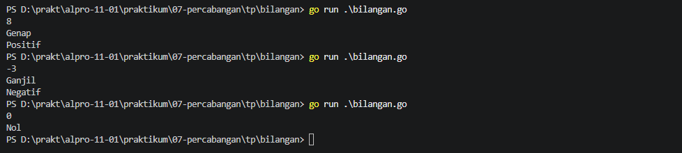
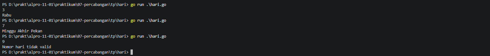
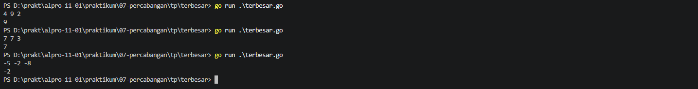

# <h1 align="center">Tugas Pendahuluan Modul 06 - Percabangan</h1>
<p align="center">Zeda Briyan Dinillah - 109092600014</p>

### 1. Perbedaan
1. Perbedaan `if`, `if-else`, `else-if`
- `if` digunakan ketika hanya memiliki satu kondisi yang ingin diperiksa. Kode di dalam `if` akan dijalankan jika kondisi bernilai `true`.
- `if-else` digunakan jika memiliki dua kondisi keputusan. Jika kondisi pada `if` bernilai `true`, kode dalam `if` akan dijalankan. Sebaliknya, jika `false` maka kondisi dalam `else` yang akan dijalankan.
- `else-if` digunakan ketika memiliki lebih dari 2 kondisi keputusan. Go akan mengevaluasi kondisi dari atas ke bawah hingga menemukan kondisi yang bernilai `true`.
2. Perbedaan `switch` pada Go dan Java
- Setiap baris `case` pada Go akan otomatis berhenti setelah kodenya dieksekusi, jika ingin melanjutkan ke kode berikutnya, harus menggunakan `falltrough`. Di Java, kode akan otomatis melanjutkan ke kode dibawahnya kecuali ada pernyataan `break` diakhir `case`.
### 2. bilangan.go

```go
package main
import "fmt"

func main() {
	var x int
	fmt.Scan(&x)

	if x == 0 {
		fmt.Println("Nol")
	} else if x % 2 == 0 {
		fmt.Println("Genap")
		if x < 0 {
			fmt.Println("Negatif")
		} else if x >= 0 {
			fmt.Println("Positif")
		}
	} else if x % 2 != 0 {
		fmt.Println("Ganjil")
		if x < 0 {
			fmt.Print("Negatif")
		} else if x >= 0 {
			fmt.Println("Positif")
		}
	}
}
```

#### Output



#### Deskripsi
Program untuk menentukan apakah bilangan yang dimasukkan merupakan bilangan genap atau ganjil, dan apakah bilangan tersebut bernilai negatif atau positif. Percabangan digunakan untuk menentukan apakah bilangan input merupakan angka nol, bilangan genap, atau ganjil. Setelah program menemukan apakah bilangan masukkan merupakan genap atau ganjil, program menggunakan percabangan kembali untuk menentukan positif atau negatifnya.

### 3. hari.go

```go
	package main
	import "fmt"

	func main() {
		var hari int
		fmt.Scan(&hari)

		switch {
		case hari == 1:
			fmt.Println("Senin")
		case hari == 2:
			fmt.Println("Selasa")
		case hari == 3:
			fmt.Println("Rabu")
		case hari == 4:
			fmt.Println("Kamis")
		case hari == 5:
			fmt.Println("Jumat")
		case hari == 6:
			fmt.Println("Sabtu", "Akhir Pekan")
		case hari == 7:
			fmt.Println("Minggu", "Akhir Pekan")
		default:
			fmt.Println("Nomor hari tidak valid")
		}
	}
```

##### Output



#### Deskripsi
Program untuk menentukan hari berdasarkan masukkan suatu angka dari 1-7, untuk 1 = Senin, 2 = Selasa, dan seterusnya. Jika hari merupakan sabtu dan minggu, maka akan muncul keterangan "Akhir pekan". Percabangan `switch` digunakan untuk mengaitkan angka dengan nama hari, dan jika angka lebih dari 7, maka akan tampil pesan "Nomor hari tidak valid".

### 4. terbesar.go

```go
package main
import "fmt"

func main() {
	var a,b, c, terbesar int
	fmt.Scan(&a, &b, &c)

	if a >=b && a >= c {
		terbesar = a
	} else if b >= a && b >= c {
		terbesar = b
	} else {
		terbesar = c
	}
	fmt.Println(terbesar)
}
```
#### Output



#### Deskripsi
Program untuk menemukan bilangan terbesar dari tiga buah bilangan bulat yang dimasukkan. Percabangan digunakan untuk membandingkan ketiga bilangan masukkan dan menemukan bilangan terbesarnya.

## Kesimpulan
Kesimpulan dari tugas pendahuluan ini yaitu penggunaan `if`, `else`, `switch`, dan `case` dalam sebuah program Go.