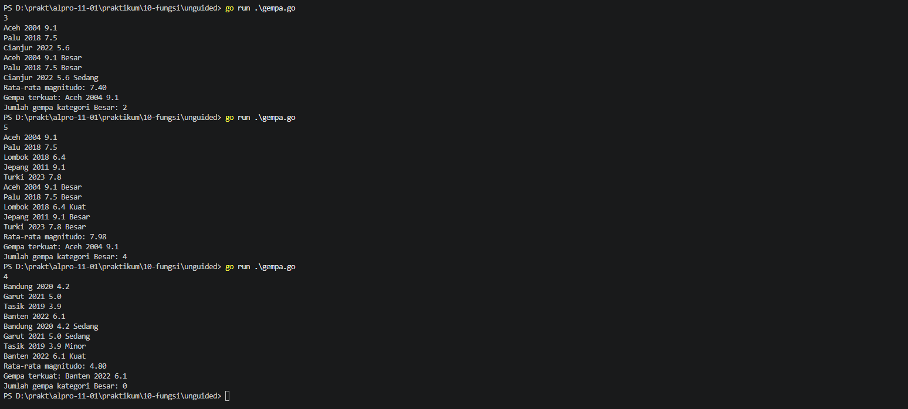

# <h1 align="center">Laporan Praktikum Modul 10 - Fungsi</h1>
<p align="center">Zeda Briyan Dinillah - 109092600014</p>

## Dasar Teori

### A. Fungsi
Fungsi, atau `func` adalah blok kode terisolasi dan dapat digunakan kembali untuk menjalankan tugas. Fungsi membantu memecah program besar menjadi bagian-bagian yang lebih kecil dan lebih mudah dibaca, diuji, dan dikelola. Suatu subprogram dikatakan sebagai fungsi jika:
1. Ada deklarasi nilai yang dikembalikan
2. Terdapat `return` dalam badan subprogram

### B. _Parameter_ dan _Pointer_
#### 1. _Parameter_ 
Adalah variabel lokal yang dideklarasikan didalam tanda kurung pada fungsi (`func(-parameter-)`) untuk menerima nilai input saat fungsi dipanggil nantinya. Secara _default_, Go mengirim _parameter_ dengan mekanisme _Pass by Value_, yakni Go membuat duplikat dari nilai variabel di alamat memori baru.
#### 2. _Pointer_
Adalah variabel khusus yang tidak menyimpan nilai secara langsung, melainkan menyimpan alamat memori tempat nilai berada. Ada dua operator utama dalam _pointer_, yaitu:
1. _Address-of_ (`&`), digunakan untuk mendapatkan alamat memori tempat variabel berada, bukan nilai variabelnya.
2. _Dereference_ (`*`), digunakan untuk mengakses nilai sebuah variabel.

### C. _Array_ dan _Struct_
#### 1. _Array_
Adalah sekumpulan variabel dengan tipe data yang sama dan ukuran yang tetap. Setelah dideklarasikan, ukuran dari _array_ tidak dapat ditambah atau dikurangi.
#### 2. _Struct_
Adalah sekumpulan variabel dengan tipe data yang dapat berbeda-beda. 

## Guided

### 1. Nama File: player.go

```go
package main

import "fmt"

const NMAX int = 999

type player struct {
	nickname string
	score    int
}

type tabPlayer [NMAX]player

func rataRata(T tabPlayer, n int) float64 {
	total := 0
	for i := 0; i < n; i++ {
		total += T[i].score
	}
	return float64(total) / float64(n)
}

func idxTertinggi(T tabPlayer, n int) int {
	idx := 0
	for i := 1; i < n; i++ {
		if T[i].score > T[idx].score {
			idx = i
		}
	}
	return idx
}

func hitungDiAtas(T tabPlayer, n int, batas float64) int {
	count := 0
	for i := 0; i < n; i++ {
		if float64(T[i].score) > batas {
			count++
		}
	}
	return count
}

func main() {
	var T tabPlayer
	var n int
	fmt.Scan(&n)
	for i := 0; i < n; i++ {
		fmt.Scan(&T[i].nickname, &T[i].score)
	}

	avg := rataRata(T, n)
	best := idxTertinggi(T, n)
	di := hitungDiAtas(T, n, avg)

	fmt.Printf("Rata-rata skor: %.2f\n", avg)
	fmt.Printf("Player terbaik: %s (%d)\n", T[best].nickname, T[best].score)
	fmt.Printf("Jumlah player di atas rata-rata: %d\n", di)
}
```
#### Deskripsi
Membuat program untuk data mengolah skor pemain sebuah turnamen _game_. Fungsi digunakan untuk menghitung rata-rata skor, mencari pemain dengan skor tertinggi, dan mencari jumlah pemain yang skornya diatas rata-rata.

## Unguided

### 1. Gempa

```go
package main
import "fmt"
const NMAX int = 999
type gempa struct {
	nama string
	tahun int
	magnitudo float64
}
type tabGempa [NMAX]gempa

func kategori(m float64) string {
	if m < 4.0 {
		return "Minor"
	} else if m >= 4.0 && m < 6.0 {
		return "Sedang"
	} else if m >= 6.0 && m < 7.0 {
		return "Kuat"
	} else {
		return "Besar"
	}
}
func rataMagnitudo(T tabGempa, n int) float64 {
	var total float64
	for i := 0; i < n; i++ {
		total = total + T[i].magnitudo
	}
	return total / float64(n)
}
func idxTerkuat(T tabGempa, n int) int {
	var idxMax int
	for i := 0; i < n; i++ {
		if T[i].magnitudo > T[idxMax].magnitudo {
			idxMax = i
		}
	}
	return idxMax
}
func hitungKategori(T tabGempa, n int, k string) int {
	var hitung int
	for i := 0; i < n; i++ {
		if kategori(T[i].magnitudo) == k {
			hitung += 1
		}
	}
	return hitung
}
func main() {
	var n, idxMax, Besar int
	var rataRata float64
	var dataGempa tabGempa
	fmt.Scan(&n)

	for i := 0; i < n; i++ {
		fmt.Scan(&dataGempa[i].nama, &dataGempa[i].tahun, &dataGempa[i].magnitudo)
	}
	for i := 0; i < n; i++ {
		fmt.Printf("%s %d %.1f %s\n", dataGempa[i].nama, dataGempa[i].tahun, dataGempa[i].magnitudo, kategori(dataGempa[i].magnitudo))
	}
	rataRata = rataMagnitudo(dataGempa, n)
	idxMax = idxTerkuat(dataGempa, n)
	Besar = hitungKategori(dataGempa, n, "Besar")

	fmt.Printf("Rata-rata magnitudo: %.2f\n", rataRata)
	fmt.Printf("Gempa terkuat: %s %d %.1f\n", dataGempa[idxMax].nama, dataGempa[idxMax].tahun, dataGempa[idxMax].magnitudo)
	fmt.Println("Jumlah gempa kategori Besar:", Besar)
}
```

##### Output


#### Deskripsi
Membuat program untuk mengklasifikasikan kategori gempa, menghitung rata-rata magnitudo, mencari gempa terkuat, dan banyaknya gempa berkategori Besar. Fungsi pertama (`func kategori(m float64) string`), digunakan untuk mengkategorikan gempa berdasarkan magnitudo. Fungsi kedua (`func rataMagnitudo(T tabGempa, n int) float64`), digunakan untuk menghitung rata-rata magnitudo gempa. Fungsi ketiga (`func idxTerkuat(T tabGempa, n int) int`), digunakan untuk mencari gempa terkuat. Fungsi keempat (`func hitungKategori(T tabGempa, n int, k string) int`), digunakan untuk menjumlahkan semua kategori gempa, dari "Minor", sampai "Besar". Fungsi terakhir dan yang utama (`func main()`) digunakan untuk menampung input, menghitung jumlah gempa berkategori "Besar", dan mengeluarkan output.


## Kesimpulan
1. Fungsi adalah blok kode terisolasi yang dapat dipanggil kembali untuk menjalankan tugas.
2. Subprogram dikatan fungsi apabila ada deklarasi nilai yang dikembalikan, dan terdapat `return` didalamnya.
3. _Parameter_ adalah variabel lokal yang dideklarasikan didalam tanda kurung. Sedangkan _pointer_ adalah variabel khusus yang tidak menyimpan nilai secara langsung. _Pointer_ memiliki dua operator utama, yaitu _address-of_, dan _dereference_.
4. _Array_ adalah sekumpulan variabel dengan tipe data sama. _Struct_ adalah sekumpulan variabel dengan tipe data yang dapat berbeda-beda.