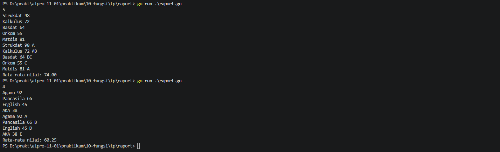
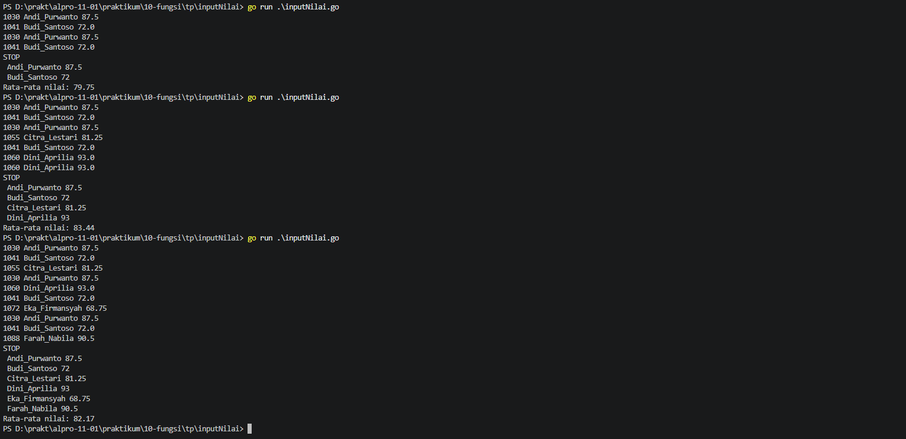

# <h1 align="center">Tugas Pendahuluan Modul 10 - Fungsi</h1>
<p align="center">Zeda Briyan Dinillah - 109092600014</p>

### 1. raport.go

```go
package main
import "fmt"
const NMAX int = 999
type rapot struct {
	matkul string
	nilai int
}
type tabRapot [NMAX]rapot

func nilaiHuruf(x int) string {
	if x > 80 && x <= 100 {
		return "A"
	} else if x > 70 && x <= 80 {
		return "AB"
	} else if x > 65 && x <= 70 {
		return "B"
	} else if x > 60 && x <= 65 {
		return "BC"
	} else if x > 50 && x <= 60 {
		return "C"
	} else if x > 40 && x <= 50 {
		return "D"
	} else {
		return "E"
	}
}
func rataRata(T tabRapot, n int) float64 {
	total := 0
	for i := 1; i <= n; i++ {
		total += T[i].nilai
	}
	return float64(total) / float64(n)
}
func main() {
	var data tabRapot 
	var n int
	fmt.Scan(&n)

	for i := 1; i <= n; i++ {
		fmt.Scan(&data[i].matkul, &data[i].nilai)
	}
	for i := 1; i <= n; i++ {
		fmt.Printf("%s %d %s\n", data[i].matkul, data[i].nilai, nilaiHuruf(data[i].nilai))
	}
	fmt.Printf("Rata-rata nilai: %.2f\n", rataRata(data, n))
}
```

#### Output



#### Deskripsi
Program untuk menampilkan nama mata kuliah beserta nilai huruf, kemudian menampilkan rata-rata nilai seluruh mata kuliah. Ada tiga fungsi (`func`) didalam program ini. Fungsi pertama (`func nilaiHuruf(x int) string`) berguna untuk mengonversi nilai angka (`int`) menjadi nilai huruf (`string`). Fungsi kedua (`func rataRata(T tabRapot, n int) float64`) menjumlahkan seluruh nilai angka dan membaginya dengan jumlah mata kuliah untuk menghasilkan rata-rata nilai. Fungsi terakhir sekaligus fungsi utama (`func main`) merupakan titik masuk utama program yang berfungsi menyiapkan variabel array, membaca input, memanggil fungsi pertama dan fungsi kedua, 

### 2. inputNilai.go

```go
package main
import "fmt"
const NMAX int = 100
type student struct {
	nim, name string
	grade float64
}
type students [NMAX]student

func cariNIM(T students, n int, nim string) int {
	for i := 0; i < n; i++ {
		if T[i].nim == nim {
			return i
		}
	}
	return -1
}
func rataRata(T students, n int) float64 {
	if n == 0 {
		return 0
	}
	var total float64 = 0
	for i := 0; i < n; i++ {
		total += T[i].grade
	}
	return total / float64(n)
}
func main() {
	var data students
	var n int = 0
	var nim, name string
	var grade float64

	for {
		fmt.Scan(&nim)
		if nim == "STOP" {
			break
		}
		fmt.Scan(&name, &grade)

		if cariNIM(data, n, nim) == -1 && n < NMAX {
			data[n].nim = nim
			data[n].name = name
			data[n].grade = grade
			n++
		}
	}
	for i := 0; i < n; i++ {
		fmt.Println(data[n].nim, data[i].name, data[i].grade)
	}
	fmt.Printf("Rata-rata nilai: %.2f\n", rataRata(data, n))
}

```

##### Output



#### Deskripsi
Program untuk 

## Kesimpulan
Kesimpulan dari tugas pendahuluan ini yaitu cara penerapan fungsi atau `func` dalam sebuah program Go.