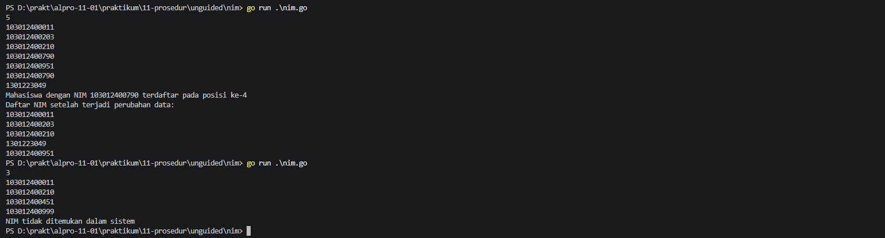

# <h1 align="center">Laporan Praktikum Modul 11 - Prosedur</h1>
<p align="center">Zeda Briyan Dinillah - 109092600014</p>

## Dasar Teori

### A. Prosedur
Prosedur adalah blok kode terisolasi untuk menjalankan suatu perintah tanpa mengembalikan nilai apapun. Perbedaannya dengan fungsi adalah jika fungsi bertugas melakukan tugas dan menyerahkan `return`, prosedur bertugas melakukan tugas, lalu selesai. Suatu subprogram dikatakan prosedur jika:
1. Tidak ada deklarasi tipe nilai yang dikembalikan.
2. Tidak terdapat `return` dalam badan subprogram.

### B. _Parameter_ dan _Pointer_
#### 1. _Parameter_ 
Adalah variabel lokal yang dideklarasikan didalam tanda kurung pada fungsi (`func(-parameter-)`) untuk menerima nilai input saat fungsi dipanggil nantinya. Secara _default_, Go mengirim _parameter_ dengan mekanisme _Pass by Value_, yakni Go membuat duplikat dari nilai variabel di alamat memori baru.
#### 2. _Pointer_
Adalah variabel khusus yang tidak menyimpan nilai secara langsung, melainkan menyimpan alamat memori tempat nilai berada. Ada dua operator utama dalam _pointer_, yaitu:
1. _Address-of_ (`&`), digunakan untuk mendapatkan alamat memori tempat variabel berada, bukan nilai variabelnya.
2. _Dereference_ (`*`), digunakan untuk mengakses nilai sebuah variabel.

### C. _Array_ dan _Struct_
#### 1. _Array_
Adalah sekumpulan variabel dengan tipe data yang sama dan ukuran yang tetap. Setelah dideklarasikan, ukuran dari _array_ tidak dapat ditambah atau dikurangi.
#### 2. _Struct_
Adalah sekumpulan variabel dengan tipe data yang dapat berbeda-beda. 

## Guided

### 1. Nama File: sapi.go
```go
package main

import "fmt"

const NMAX = 10000

type Arr [NMAX]int

func mengisiSapi(T *Arr, n int) {
	for i := 0; i < n; i++ {
		fmt.Scan(&T[i])
	}
}

func geserKanan(T *Arr, n int) {
	var temp int = T[n-1]

	for i := n - 1; i > 0; i-- {
		T[i] = T[i-1]
	}

	T[0] = temp
}

func cetak(T Arr, n int) {
	for i := 0; i < n; i++ {
		fmt.Print(T[i], " ")
	}
	fmt.Println()
}

func main() {
	var n, k int
	fmt.Scan(&n, &k)

	var T Arr
	mengisiSapi(&T, n)

	k = k % n

	for i := 0; i < k; i++ {
		geserKanan(&T, n)
	}

	cetak(T, n)

}
```
#### Deskripsi
Membuat program untuk memindahkan sapi dengan aturan sapi di kandang terakhir pindah ke kandang pertama, sedangkan sapi lainnya bergeser satu kandang ke kanan.

## Unguided

### 1. NIM

```go
package main
import "fmt"
const NMAX int = 2002
type tabNIM [NMAX]int

func cariNIM(T tabNIM, n, x int, idx *int) {
	*idx = -1
	for i := 0; i < n && *idx == -1; i++ {
		if T[i] == x {
			*idx = i
		}
	}
}
func ubahNIM(T *tabNIM, idx, baru int) {
	T[idx] = baru
}
func cetak(T tabNIM, n int) {
	for i := 0; i < n; i++ {
		fmt.Println(T[i])
	}
}
func main() {
	var n, cari, pengganti, idx int
	var daftarNIM tabNIM
	fmt.Scan(&n)

	for i := 0; i < n; i++ {
		fmt.Scan(&daftarNIM[i])
	}
	
	fmt.Scan(&cari)
	cariNIM(daftarNIM, n, cari, &idx)

	if idx != -1 {
		fmt.Scan(&pengganti)
		ubahNIM(&daftarNIM, idx, pengganti)
		fmt.Printf("Mahasiswa dengan NIM %d terdaftar pada posisi ke-%d\n", cari, idx + 1)
		fmt.Println("Daftar NIM setelah terjadi perubahan data:")
		cetak(daftarNIM, n)
	} else {
		fmt.Println("NIM tidak ditemukan dalam sistem")
	}
}
```

##### Output


#### Deskripsi
Membuat program untuk mencari apakah seorang mahasiswa terdaftar dari NIM-nya. Jika ditemukan, NIM mahasiswa diubah dengan NIM pengganti. Program ini memiliki tiga prosedur. Prosedur pertama (`func cariNIM(T tabNIM, n, x int, idx *int)`), digunakan untuk mencari NIM `x` didalam _array_ `T` sepanjang `n` kali, lalu menyimpan indeks pertama ke _parameter out_ `idx`, atau `-1` jika tidak ditemukan. Prosedur kedua (`func ubahNIM(T *tabNIM, idx, baru int)`), digunakan untuk merubah NIM pada indeks `idx` dalam _array_ `T`, dan dikirim sebagai _pointer_ `*tabNIM` menjadi nilai `baru`. Prosedur terakhir (`func cetak(T tabNIM, n int)`), digunakan untuk menampilkan seluruh _array_ `T` dari indeks `0` hingga `n-1`.


## Kesimpulan
1. Prosedur adalah blok kode terisolasi untuk menjalankan suatu perintah tanpa mengembalikan nilai apapun.
2. Perbedaannya dengan fungsi, prosedur melakukan tugas lalu selesai, tanpa memberi `return`.
3. Subprogram dikatakan prosedur jika tidak ada deklarasi tipe nilai yang dikembalikan, dan tidak terdapat `return` didalamnya.
4. _Parameter_ adalah variabel lokal yang dideklarasikan didalam tanda kurung. Sedangkan _pointer_ adalah variabel khusus yang tidak menyimpan nilai secara langsung. _Pointer_ memiliki dua operator utama, yaitu _address-of_, dan _dereference_.
5. _Array_ adalah sekumpulan variabel dengan tipe data sama. _Struct_ adalah sekumpulan variabel dengan tipe data yang dapat berbeda-beda.