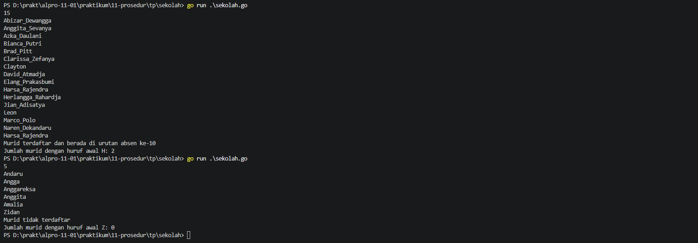
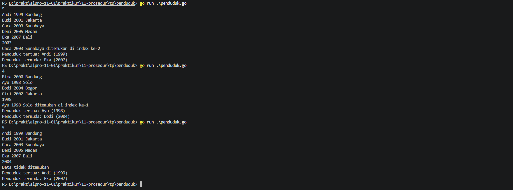

# <h1 align="center">Tugas Pendahuluan Modul 11 - Prosedur</h1>
<p align="center">Zeda Briyan Dinillah - 109092600014</p>

### 1. sekolah.go

```go
package main
import "fmt"
const NMAX int = 1001
type tabMurid [NMAX] string

func cariMurid(T tabMurid, n int, nama string, posisi *int, ketemu *bool) {
	for i := 0; i < n; i++ {
		if T[i] == nama {
			*ketemu = true
			*posisi = i + 1
			return
		}
	}
}
func hitungHuruf(T tabMurid, n int, h byte, jumlah *int) {
	for i := 0; i < n; i++ {
		if len(T[i]) > 0 && T[i][0] == h {
			*jumlah++
		}
	}
}
func main() {
	var data tabMurid
	var n, posisi, jumlah int
	var cari string
	var ketemu bool

	fmt.Scan(&n)
	for i := 0; i < n; i++ {
		fmt.Scan(&data[i])
	}
	fmt.Scan(&cari)
	cariMurid(data, n, cari, &posisi, &ketemu)

	if ketemu {
		fmt.Printf("Murid terdaftar dan berada di urutan absen ke-%d\n", posisi)
	} else {
		fmt.Println("Murid tidak terdaftar")
	}

	var awal byte = cari[0]
	hitungHuruf(data, n, awal, &jumlah)
	fmt.Printf("Jumlah murid dengan huruf awal %c: %d\n", awal, jumlah)
}
```

#### Output



#### Deskripsi
Program untuk mencari apakah murid terdaftar, dan menghitung banyak murid yang namanya diawali huruf yang sama dengan huruf pertama nama yang dicari. Fungsi digunakan untuk memeriksa apakah seorang murid terdaftar, dan menghitung banyak murid yang namanya diawali huruf yang sama dengan huruf pertama nama yang dicari

### 2. penduduk.go

```go
package main
import "fmt"
const NMAX int = 1000
type penduduk struct {
	nama string
	tahun int
	kota string
}
type tabPenduduk [NMAX]penduduk

func cariTahun(T tabPenduduk, n, th int, idx *int) {
	*idx = -1
	for i := 0; i < n && *idx == -1; i++ {
		if T[i].tahun == th {
			*idx = i
		}
	}
}
func tertuaTermuda(T tabPenduduk, n int, tua, muda *penduduk) {
	*tua = T[0]
	*muda = T[0]
	for i := 1; i < n; i++ {
		if T[i].tahun < tua.tahun {
			*tua = T[i]
		}
		if T[i].tahun > muda.tahun {
			*muda = T[i]
		}
	}
}
func main() {
	var data tabPenduduk
	var n, thCari, idx int
	var tua, muda penduduk
	
	fmt.Scan(&n)
	for i := 0; i < n; i++ {
		fmt.Scan(&data[i].nama, &data[i].tahun, &data[i].kota)
	}

	fmt.Scan(&thCari)
	cariTahun(data, n, thCari, &idx)
	if idx != -1 {
		fmt.Printf("%s %d %s ditemukan di index ke-%d\n", data[idx].nama, data[idx].tahun, data[idx].kota, idx)
	} else {
		fmt.Println("Data tidak ditemukan")
	}

	tertuaTermuda(data, n, &tua, &muda)
	fmt.Printf("Penduduk tertua: %s (%d)\n", tua.nama, tua.tahun)
	fmt.Printf("Penduduk termuda: %s (%d)\n", muda.nama, muda.tahun)
}
```

##### Output



#### Deskripsi
Program untuk menyimpan data penduduk yang terdiri dari nama, tahun lahir, dan kota asal. Fungsi digunakan untuk menelusuri data penduduk dan menyimpan indeks yang cocok dengan tahun lahir kedalam pointer, 

## Kesimpulan
Kesimpulan dari tugas pendahuluan ini yaitu cara penerapan prosedur dalam Go.