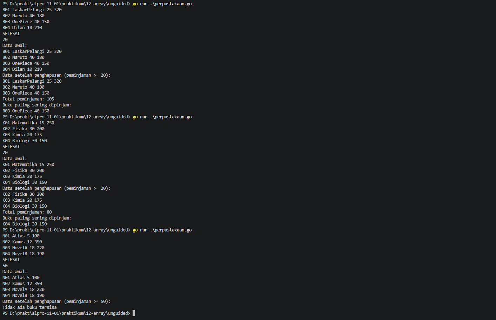

# <h1 align="center">Laporan Praktikum Modul 12 - Array</h1>
<p align="center">Zeda Briyan Dinillah - 109092600014</p>

## Dasar Teori

### A. _Array_
Array adalah suatu struktur data yang menyimpan sekumpulan elemen dengan tipe data yang sama dan memiliki ukuran tetap.

### B. _Array_ 1D dan _Array_ Multidimensi
#### 1. _Array_ 1D merupakan jenis _array_ yang hanya memiliki satu arah urutan. Setiap elemen diidentifikasi dengan nomor indeks yang dimulai dari `0` sampai `n - 1`
#### 2. _Array_ multidimensi adalah jenis _array_ yang memiliki dua atau lebih arah urutan. Untuk mengakses sebuah elemen, diperlukan dua indeks, indeks pertama menentukan posisi baris, indeks kedua menentukan posisi kolom.

### C. _Alias_ dan _Structure_
#### 1. _Alias_, atau dalam Go dideklarasikan dengan `type`,  berfungsi untuk mendefinisikan tipe data baru berdasarkan tipe data yang sudah ada (seperti `int`, `string`, dll.). Tipe data yang didefinisi harus sama dan tidak boleh berbeda-beda.
#### 2. _Structure_, atau dalam Go dideklarasikan dengan `struct`, memiliki fungsi yang sama dengan `type`, namun `struct` dapat menyimpan tipe data yang berbeda-beda.

### D. `slice`
`slice` adalah struktur data dinamis yang menjadi potongan dari sebuah array. 
Tiga komponen utama dari `slice` adalah:
1. _Pointer_: Penunjuk ke alamat memori pertama pada _array_.
2. _Length_ (`len`): Jumlah elemen yang saat ini ada pada `slice`.
3. _Capacity_ (`cap`): Jumlah maksimum elemen yang dapat ditampung oleh `slice`.

## Guided

### 1. curah.go
```go
package main

import "fmt"

const NMAX int = 9999

type arrReal [NMAX]float64

// Procedure bacaData(in/out A : arrReal, in n : integer)
func bacaData(A *arrReal, n int) {
	for i := 0; i < n; i++ {
		fmt.Scan(&A[i])
	}
}

// Procedure cetakData(in A : arrReal, in n : integer)
func cetakData(A arrReal, n int) {
	for i := 0; i < n; i++ {
		if i == n-1 {
			fmt.Printf("%.1f.\n", A[i])
		} else {
			fmt.Printf("%.1f, ", A[i])
		}
	}
}

// Procedure cariMaksMin(in A : arrReal, in n : integer, out iMaks, iMin : integer)
func cariMaksMin(A arrReal, n int, iMaks, iMin *int) {
	*iMaks = 0
	*iMin = 0
	for i := 1; i < n; i++ {
		// Menggunakan > dan < (bukan >= atau <=) agar jika ada nilai sama, indeks pertama yang diambil
		if A[i] > A[*iMaks] {
			*iMaks = i
		}
		if A[i] < A[*iMin] {
			*iMin = i
		}
	}
}

// Function rataRata(A : arrReal, n : integer) -> real
func rataRata(A arrReal, n int) float64 {
	var total float64 = 0
	for i := 0; i < n; i++ {
		total += A[i]
	}
	return total / float64(n)
}

// Procedure balikData(in/out A : arrReal, in n : integer)
func balikData(A *arrReal, n int) {
	var temp float64
	for i := 0; i < n/2; i++ {
		temp = A[i]
		A[i] = A[n-1-i]
		A[n-1-i] = temp
	}
}

func main() {
	var data arrReal
	var n, iMaks, iMin int

	// Baca banyaknya data N
	fmt.Scan(&n)

	// Validasi batas N sesuai soal (1 <= N <= 9999)
	if n >= 1 && n <= NMAX {
		// 1. Baca N data curah hujan
		bacaData(&data, n)

		// 2. Cetak data awal
		fmt.Print("Data awal: ")
		cetakData(data, n)

		// 3. Cari dan cetak nilai tertinggi & terendah beserta posisinya (indeks + 1)
		cariMaksMin(data, n, &iMaks, &iMin)
		fmt.Printf("Tertinggi: %.1f (data ke-%d)\n", data[iMaks], iMaks+1)
		fmt.Printf("Terendah: %.1f (data ke-%d)\n", data[iMin], iMin+1)

		// 4. Hitung dan cetak rata-rata (2 angka di belakang koma)
		fmt.Printf("Rata-rata: %.2f\n", rataRata(data, n))

		// 5. Balik urutan elemen tanpa array bantuan dan cetak hasilnya
		balikData(&data, n)
		fmt.Print("Data setelah dibalik: ")
		cetakData(data, n)
	}
}
```
#### Deskripsi
Membuat program untuk menampung data curah hujan bulanan (dalam mm) dari sebuah kota dan menyimpannya di _array_. Kemudian, program menampilkan data awal, curah hujan terendah dan tertinggi beserta posisinya dalam _array_, rata-rata curah hujan, serta data setelah dibalik. _Array_ digunakan untuk menyimpan data dan digunakan kembali untuk membalik data urutan elemen.

## Unguided

### 1. Perpustakaan

```go
package main
import "fmt"
const NMAX int = 100
type book struct {
	code, title string
	borrowed, pages int
}
type books [NMAX]book

func bacaData(T *books, n *int) {
	var kode string
	*n = 0
	fmt.Scan(&kode)
	for kode != "SELESAI" && *n < NMAX {
		T[*n].code = kode
		fmt.Scan(&T[*n].title, &T[*n].borrowed, &T[*n].pages)
		*n++
		fmt.Scan(&kode)
	}
}
func cetakData(T books, n int) {
	for i := 0; i < n; i++ {
		fmt.Println(T[i].code, T[i].title, T[i].borrowed, T[i].pages)
	}
}
func hapusBuku(T *books, n *int, x int) {
	i := 0
	for i < *n {
		if T[i].borrowed < x {
			for j := i; j < *n-1; j++ {
				T[j] = T[j+1]
			}
			*n--
		} else {
			i++
		}
	}
}
func totalPinjam(T books, n int) int {
	total := 0
	for i := 0; i < n; i++ {
		total += T[i].borrowed
	}
	return total
}
func idxFavorit(T books, n int) int {
	idxMax := 0
	for i := 0; i < n; i++ {
		if T[i].borrowed > T[idxMax].borrowed || (T[i].borrowed ==  T[idxMax].borrowed && T[i].pages < T[idxMax].pages) {
			idxMax = i
		}
	}
	return idxMax
}
func main() {
	var T books
	var n, x int

	bacaData(&T, &n)
	fmt.Scan(&x)

	fmt.Println("Data awal:")
	cetakData(T, n)

	hapusBuku(&T, &n, x)

	fmt.Printf("Data setelah penghapusan (peminjaman >= %d):\n", x)

	if n == 0 {
		fmt.Println("Tidak ada buku tersisa")
	} else {
		cetakData(T, n)
		fmt.Println("Total peminjaman:", totalPinjam(T, n))
		idxFav := idxFavorit(T, n)
		fmt.Println("Buku paling sering dipinjam:")
		fmt.Println(T[idxFav].code, T[idxFav].title, T[idxFav].borrowed, T[idxFav].pages)
	}
}
```

##### Output


#### Deskripsi
Membuat program untuk merapikan data buku. Data buku terdiri dari kode, judul, jumlah peminjaman, dan jumlah halaman buku dan disimpan didalam _array_. Kemudian, program menghapus buku yang kurang dari batas $X$. Terakhir, program menampilkan total peminjaman dan buku yang paling sering dipinjam, jika ada buku dengan jumlah peminjaman tertinggi yang sama, program akan menampilkan buku dengan jumlah halaman yang paling sedikit. _Array_ digunakan menyimpan variabel/elemen dalam program.


## Kesimpulan
1. Array adalah suatu struktur data yang menyimpan sekumpulan elemen dengan tipe data yang sama dan memiliki ukuran tetap.
2. _Array_ 1D hanya memiliki satu arah urutan, sedangkan _array_ multidimensi memiliki dua atau lebih arah urutan.
3. _Alias_ (`type`) berfungsi mendefinisikan tipe data baru berdasarkan tipe data yang sudah ada. Tipe data yang didefinisi harus sama. _Structure_ (`struct`) sama dengan _alias_, namun dapat menyimpan tipe data yang berbeda.
4. `slice` adalah struktur data dinamis yang menjadi potongan sebuah _array_. Tiga komponen utamanya yaitu _pointer_, _length_ (`len`), dan _capacity_ (`cap`)