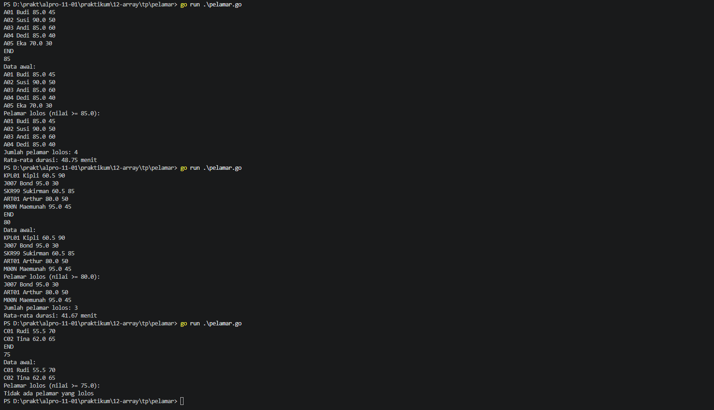
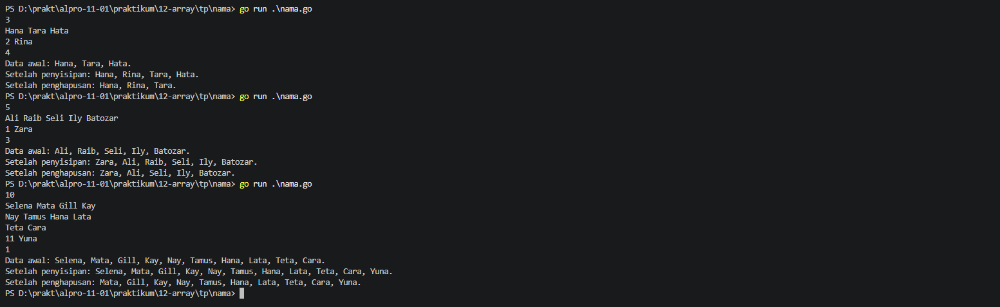

# <h1 align="center">Tugas Pendahuluan Modul 12 - Array</h1>
<p align="center">Zeda Briyan Dinillah - 109092600014</p>

### 1. pelamar.go

```go
package main
import "fmt"
const NMAX int = 100
type applicant struct {
	id, name string
	testGrade float64
	testDuration int
}
type applicants [NMAX]applicant

func salinLolos(A applicants, n int, batas float64, B *applicants, m *int) {
	*m = 0
	for i := 0; i < n; i++ {
		if A[i].testGrade >= batas {
			B[*m] = A[i]
			*m++
		}
	}
}
func rataDurasi(B applicants, m int) float64 {
	total := 0
	for i := 0; i < m; i++ {
		total += B[i].testDuration
	}
	return float64(total) / float64(m)
}
func main() {
	var A, B applicants
	var n, m int
	var batas, rataRata float64
	var temp string
	n = 0

	fmt.Scan(&temp)
	for temp != "END" && n < NMAX {
		A[n].id = temp
		fmt.Scan(&A[n].name, &A[n].testGrade, &A[n].testDuration)
		n++
		fmt.Scan(&temp)
	}
	
	fmt.Scan(&batas)
	salinLolos(A, n, batas, &B, &m)

	fmt.Println("Data awal:")
	for i := 0; i < n; i++ {
		fmt.Printf("%s %s %.1f %d\n", A[i].id, A[i].name, A[i].testGrade, A[i].testDuration)
	}

	fmt.Printf("Pelamar lolos (nilai >= %.1f):\n", batas)
	if m == 0 {
		fmt.Println("Tidak ada pelamar yang lolos")
	} else {
		for i := 0; i < m; i++ {
			fmt.Printf("%s %s %.1f %d\n", B[i].id, B[i].name, B[i].testGrade, B[i].testDuration)
		}
		rataRata = rataDurasi(B, m)
		fmt.Println("Jumlah pelamar lolos:", m)
		fmt.Printf("Rata-rata durasi: %.2f menit\n", rataRata)
	}
}
```

#### Output



#### Deskripsi
Program untuk mencari pelamar yang nilainya memenuhi batas kelulusan dan menghitung rata-rata durasi pengerjaan pelamar di sebuah perusahaan berdasarkan ID, nama, nilai, dan durasi pengerjaan.

### 2. nama.go

```go
package main
import "fmt"
const NMAX int = 9999
type arrString [NMAX]string

func bacaData(A *arrString, n int) {
	for i := 0; i < n; i++ {
		fmt.Scan(&A[i])
	}
}
func cetakData(A arrString, n int) {
	for i := 0; i < n; i++ {
		if i < n - 1 {
			fmt.Print(A[i], ", ")
		} else {
			fmt.Println(A[i] + ".")
		}
	}
}
func sisipData(A *arrString, n *int, p int, x string) {
	for i := *n; i >= p; i-- {
		A[i] = A[i-1]
	}
	A[p-1] = x
	*n++
}
func hapusData(A *arrString, n *int, q int) {
	for i := q - 1; i < *n-1; i++ {
		A[i] = A[i+1]
	}
	*n--
}
func main() {
	var A arrString
	var n, p, q int
	var x string

	fmt.Scan(&n)
	bacaData(&A, n)
	fmt.Scan(&p, &x)
	fmt.Scan(&q)

	fmt.Print("Data awal: ")
	cetakData(A, n)

	sisipData(&A, &n, p, x)
	fmt.Print("Setelah penyisipan: ")
	cetakData(A, n)

	hapusData(&A, &n, q)
	fmt.Print("Setelah penghapusan: ")
	cetakData(A, n)
}
```

##### Output



#### Deskripsi
Program untuk melakukan operasi penyisipan nama baru pada nilai P, kemudian menghapus nama pada posisi Q.

## Kesimpulan
Kesimpulan dari tugas pendahuluan ini yaitu penggunaan array pada sebuah program Go.